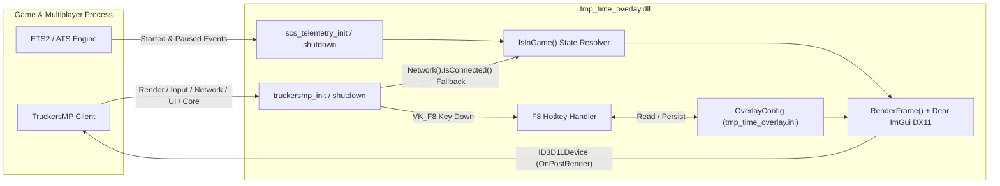

# 🚚 TruckersMP Time Overlay Plugin

[](https://www.microsoft.com/windows)
[](https://learn.microsoft.com/windows/win32/direct3d11/atoc-dx-graphics-direct3d-11)
[](https://en.cppreference.com/w/cpp/17)
[](https://github.com/TruckersMP/GameClientSDK)
[](https://github.com/ocornut/imgui)
[](CHANGELOG.md)

A lightweight, hook-free real-time clock and custom text overlay for **Euro Truck Simulator 2 (ETS2)** and **American Truck Simulator (ATS)**, built natively on the official [**TruckersMP Client SDK**](https://docs.truckersmp.com/client-sdk/).

It renders your local system time—along with up to four lines of custom text—directly onto the game screen while driving, stays out of the way in menus, and skips all GPU/UI work whenever hidden.

---

## 📖 Table of Contents

- [Preview](#-preview)
- [Key Features](#-key-features)
- [Requirements](#-requirements)
- [Installation & Quick Start](#-installation--quick-start)
- [Configuration (`tmp_time_overlay.ini`)](#-configuration-tmp_time_overlayini)
- [Architecture & How It Works](#-architecture--how-it-works)
- [Performance Engineering](#-performance-engineering)
- [Project Structure](#-project-structure)
- [Building & Testing from Source](#-building--testing-from-source)
- [Troubleshooting](#-troubleshooting)
- [Third-Party Notices](#-third-party-notices)
- [Release History](#-release-history)

---

## 📸 Preview


---

## ✨ Key Features

- **🕒 Local Real-Time Clock**: Displays high-precision Windows local time (`Current time: 18.06.2026 13:34:10 (+0800)` by default) with an optional prefix, automatic UTC/DST timezone offset, and full `strftime` pattern customization.
- **✍️ Multi-Line Custom Text**: Render up to **4 lines** of custom text (VTC tags, stream labels, reminders, including CJK/Unicode characters) directly above the clock. Empty rows are automatically collapsed.
- **⌨️ Single-Key Toggle (`F8`)**: Press **`F8`** at any time to show or hide the overlay. Your preference is immediately saved back to `tmp_time_overlay.ini` and confirmed via an in-game TruckersMP notification.
- **🎯 Context-Aware Visibility**: Automatically stays hidden on the main menu, pause screen, and loading screens—appearing only when you are actively in the driving world.
- **🎞️ Smooth Transitions**: Gently fades in and rises into place with a ~0.2 s cubic ease-out animation (`90% → 100%` scale, `16 px` vertical slide) and fades out cleanly when toggled off.
- **🛡️ Pure SDK Integration (Zero Hooks)**: No DXGI `Present` / `ResizeBuffers` detours, no `WndProc` subclassing, no memory patching, and zero interference with the client's mouse or keyboard input locks.
- **⚡ Zero Idle Overhead**: Completely short-circuits Dear ImGui and DirectX 11 state changes when off-screen, with zero per-frame heap allocations when visible.

---

## 📋 Requirements

| Requirement | Details |
| --- | --- |
| **Operating System** | Windows 10 / 11 (64-bit / `x64`) |
| **Supported Games** | Euro Truck Simulator 2 or American Truck Simulator (64-bit) |
| **TruckersMP Client** | **0.7.4.0 or newer** (required for Client SDK support) |
| **Graphics Renderer** | **DirectX 11** *(On OpenGL, the plugin loads safely, logs a notice, and disables rendering)* |

---

## 🚀 Installation & Quick Start

1. **Close the Game**
   Ensure Euro Truck Simulator 2 / American Truck Simulator and the TruckersMP launcher are completely closed.

2. **Copy the Plugin DLL**
   Place `tmp_time_overlay.dll` into your game's `plugins` directory:

   - **Euro Truck Simulator 2**:
     ```text
     <Euro Truck Simulator 2 installation folder>\bin\win_x64\plugins\tmp_time_overlay.dll
     ```
   - **American Truck Simulator**:
     ```text
     <American Truck Simulator installation folder>\bin\win_x64\plugins\tmp_time_overlay.dll
     ```

   > [!TIP]
   > If the `plugins` folder does not exist inside `bin\win_x64\`, create it manually.

3. **Launch via TruckersMP**
   Start the game **through the TruckersMP Launcher** so the TruckersMP client loads the SDK plugin. If a prompt stating **"Advanced SDK Detected"** appears during startup, click **OK / Confirm** to continue.

4. **Drive & Customize**
   - Once you enter the driving world, the clock overlay appears near the bottom of your screen.
   - Press **`F8`** to toggle the clock on or off at any time.
   - On first launch, `tmp_time_overlay.ini` is automatically generated next to `tmp_time_overlay.dll` with default settings for easy customization.

---

## 🔧 Configuration (`tmp_time_overlay.ini`)

There is intentionally **no in-game settings panel** (see [Why There Is No In-Game Settings Panel](#why-there-is-no-in-game-settings-panel)). All visual and layout options live in `tmp_time_overlay.ini` alongside `tmp_time_overlay.dll`.

The configuration file is read when the plugin initializes. To change settings, close the game, edit `tmp_time_overlay.ini`, and launch the game again.

### Configuration Reference

All settings reside under the `[overlay]` section:

| Key | Type / Range | Default | Description |
| --- | --- | --- | --- |
| `font_size` | Integer (`10` – `72`) | `16` | Font height in pixels. |
| `bottom_margin` | Integer (`0` – `300`) | `12` | Distance from the bottom edge of the screen in pixels. |
| `horizontal_percent` | Integer (`0` – `100`) | `50` | Horizontal anchor across screen width (`0` = left edge, `50` = center, `100` = right edge). Each line is centered on this anchor. |
| `text_color` | Hex `RRGGBB` | `FFFFFF` | 6-digit hexadecimal RGB color (`#` prefix optional, e.g. `FFFFFF` or `#FFD700`). Invalid values fall back to `FFFFFF`. |
| `time_visible` | `0` or `1` | `1` | Initial visibility of the clock (`1` = shown, `0` = hidden). Pressing `F8` flips and saves this value automatically. |
| `show_prefix` | `0` or `1` | `1` | Prepends `Current time: ` before the formatted timestamp. |
| `show_timezone` | `0` or `1` | `1` | Appends the local UTC offset (e.g. `(+0800)` or `(-0500)`), accounting for Daylight Saving Time. |
| `time_format` | `strftime` string | `%d.%m.%Y %H:%M:%S` | Custom date/time format pattern (max 63 bytes). Invalid or empty patterns safely fall back to `DD.MM.YYYY HH:MM:SS`. |
| `custom_text_lines` | Integer (`1` – `4`) | `1` | Number of custom text slots (`1` through `4`) evaluated above the clock. |
| `custom_text` | String | *(empty)* | Custom text row 1, drawn above the clock (max 127 UTF-8 bytes). |
| `custom_text_2` | String | *(empty)* | Custom text row 2. Empty rows are skipped without adding blank spacing. |
| `custom_text_3` | String | *(empty)* | Custom text row 3. Empty rows are skipped without adding blank spacing. |
| `custom_text_4` | String | *(empty)* | Custom text row 4. Empty rows are skipped without adding blank spacing. |

### Complete Example

```ini
[overlay]
font_size=20
bottom_margin=63
horizontal_percent=50
text_color=FFFFFF
time_visible=1
show_prefix=1
show_timezone=1
time_format=%d.%m.%Y %H:%M:%S
custom_text_lines=2
custom_text=[VTC] My Logistics Company
custom_text_2=Have a safe trip!
custom_text_3=
custom_text_4=
```

### Common `time_format` Specifiers

`time_format` supports standard C `strftime` conversion specifiers:

| Specifier | Meaning | Example Output |
| --- | --- | --- |
| `%d.%m.%Y %H:%M:%S` | Day.Month.Year 24-hour time *(default)* | `18.06.2026 13:34:10` |
| `%Y-%m-%d %H:%M:%S` | ISO-style date and 24-hour time | `2026-06-18 13:34:10` |
| `%H:%M:%S` | 24-hour time with seconds | `13:34:10` |
| `%H:%M` | Compact hours and minutes only | `13:34` |
| `%I:%M:%S %p` | 12-hour clock with AM/PM | `01:34:10 PM` |
| `%a %d %b %H:%M` | Abbreviated weekday, day, month, and time | `Thu 18 Jun 13:34` |

> [!NOTE]
> **Unicode / CJK Text in `tmp_time_overlay.ini`**: The overlay loads Microsoft YaHei (`msyh.ttc`, falling back to `segoeui.ttf`) and supports full Unicode text. Because Windows INI APIs (`GetPrivateProfileStringW`) interpret BOM-less files using the active Windows ANSI code page, save `tmp_time_overlay.ini` with **UTF-16 LE (with BOM)** encoding if you enter characters outside your system locale.

---

## 🧩 Architecture & How It Works

### Dual-SDK Coexistence

A single `tmp_time_overlay.dll` exports entry points for both official plugin interfaces, which are designed to coexist cleanly in the same module:

1. **TruckersMP Client SDK** (`truckersmp_init` / `truckersmp_shutdown`): Drives DirectX 11 post-render drawing, the `F8` hotkey, server connection checks, in-game notifications, and client logging.
2. **SCS Telemetry SDK** (`scs_telemetry_init` / `scs_telemetry_shutdown`): Uses a minimal self-contained x64 ABI definition (`v1.0` / `v1.1`) to listen only for `started` and `paused` gameplay events—requiring no external SCS SDK headers at build time.



### SDK Module Responsibilities

| TruckersMP SDK Module | Role in Plugin |
| --- | --- |
| `Render()` | Subscribes to `OnPostRender` for a clean frame boundary and borrows the client's `ID3D11Device` (`GetRendererID`, `GetDeviceHandle`). |
| `Input()` | Registers an `OnKey` listener solely for the `F8` key-down event. |
| `Network()` | Reads `IsConnected()` as a fallback signal when SCS telemetry events are unavailable. |
| `UserInterface()` | Displays in-game toast notifications when `F8` toggles the clock or when an unsupported renderer is detected. |
| `Core()` | Writes structured startup, diagnostic, and error messages to the TruckersMP client log (`Documents\ETS2MP\logs\` or `Documents\ATSMP\logs\`). |

### Three-Tier Driving State Resolution

To keep the overlay off main menus, pause screens, and loading screens without ever silently disappearing if an API is missing, `IsInGame()` resolves visibility in three tiers:

1. **SCS Telemetry Events *(Primary)*** — Shows the clock upon receiving `kScsTelemetryEventStarted` and hides it immediately on `kScsTelemetryEventPaused`.
2. **TruckersMP Connection State *(Fallback 1)*** — If telemetry events were not registered, shows the clock whenever `Network().IsConnected()` reports an active game server connection.
3. **Fail-Open Default *(Fallback 2)*** — If neither source is available, defaults to `true` so the clock remains usable rather than staying permanently hidden.

### Design & Safety Notes

#### Why There Is No In-Game Settings Panel

Releases prior to `v2.1.0` included a `Ctrl+F9` interactive settings window. Rendering an interactive panel required acquiring the TruckersMP client's cursor reference (`IncreaseMouseRef`) and locking game mouse and keyboard input (`SetGameMouseLocked` / `SetGameKeyboardLocked`) while open.

Internally, the TruckersMP client implements those input locks as **reference-counted integers**—and `IncreaseMouseRef()` transitioning from `0 → 1` increments the mouse lock counter on its own. Any imbalance across open/close/unload paths leaks a lock reference and leaves the game permanently ignoring mouse or keyboard input (an issue encountered in `v2.0` and fixed in `v2.0.2`).

Because overlay styling is a set-once preference rather than something changed mid-drive, **the panel was removed in `v2.1.0`**. The plugin now registers **zero** mouse or character listeners, feeds **zero** input events into Dear ImGui, and **never touches** the client's cursor or input lock state.

#### Deliberate Avoidance of `Network().GetLastPing()`

`Network().GetLastPing()` is intentionally never called. In TruckersMP client **0.7.7.6**, `GetLastPing()` dereferences an internal network session object without a null check; invoking it during the initial startup frames (before a server session exists) triggers an `EXCEPTION_ACCESS_VIOLATION` inside `core_ets2mp.dll` and crashes the game process.

By contrast, `Network().IsConnected()` is a direct state-field read in the same dispatch table and is safe at every stage of startup and shutdown.

---

## ⚡ Performance Engineering

Because `RenderFrame()` executes inside the game's render loop (`Render().OnPostRender`), every code path is engineered to stay off the frame-time critical path:

- **Idle-Frame Short-Circuiting**: When the clock is hidden (and its fade-out animation has reached `0.0`) or the player is in a menu, `RenderFrame()` returns immediately—skipping `OMGetRenderTargets`, `ImGui_ImplDX11_NewFrame`, `ImGui::NewFrame`, `ImGui::Render`, and `ImGui_ImplDX11_RenderDrawData`. There is **zero** DirectX 11 pipeline state backup/restore overhead while driving with the clock hidden.
- **Draw-Only UI Surface**: No mouse movement, button, wheel, or character listeners are registered, and no input queue is processed per frame.
- **Lock-Free GPU Submission**: `g_imgui_mutex` guards CPU-side ImGui vertex generation and is explicitly unlocked **before** `OMSetRenderTargets` and `ImGui_ImplDX11_RenderDrawData`, ensuring no thread ever stalls waiting on DirectX 11 driver submission.
- **Out-of-Lock Backend Initialization**: Font loading (`msyh.ttc` / `segoeui.ttf`) and DirectX 11 shader compilation run outside `g_imgui_mutex` and `g_config_mutex` (serialized only by `g_init_mutex`).
- **Multi-Tier State Caching**:
  - **Renderer ID & `ID3D11Device*`**: Cached and re-verified once every **600 frames**.
  - **Back-Buffer Dimensions**: Cached by `ID3D11RenderTargetView*` pointer identity; `D3D11_TEXTURE2D_DESC` is queried only when the render target changes (e.g., on window resize).
  - **Network Connection State**: Cached and polled at most every **250 ms** (4 Hz).
  - **Windows Timezone & DST Offset**: `GetTimeZoneInformation()` is cached and refreshed at most every **30 seconds**.
- **Zero Per-Frame Heap Allocations**: Timestamps, `strftime` output, and UTC offset strings are formatted into fixed-size stack buffers every frame.

---

## 📂 Project Structure

```text
TruckersMP-Time-Overlay-Plugin/
├── src/
│   └── tmp_time_overlay.cpp       # Plugin implementation (TruckersMP SDK + SCS Telemetry + DX11 ImGui)
├── tests/
│   └── plugin_smoke.cpp           # Standalone mock-host integration smoke test (20 assertions)
├── external/
│   ├── GameClientSDK/             # Header-only TruckersMP Client SDK (MIT)
│   └── imgui/                     # Vendored Dear ImGui v1.92.9 + Win32/DX11 backends (MIT)
├── tools/
│   └── make-d3dcompiler-lib.sh    # Generates libd3dcompiler.a for Zig's MinGW sysroot
├── dist/                          # Prebuilt release DLL, notices, and packaged archive
├── build.sh                       # Portable build & smoke-test script using Zig C++
├── tmp_time_overlay.vcxproj       # Visual Studio 2022 (v143) C++17 x64 project
├── CHANGELOG.md                   # Detailed version history
└── THIRD_PARTY_NOTICES.md         # Third-party license attributions
```

---

## 🔨 Building & Testing from Source

All third-party headers (`Dear ImGui` and `TruckersMP Client SDK`) are vendored in `external/`. You only need a C++17 compiler targeting Windows x64.

### Option 1: Portable Zig C++ Toolchain (Recommended)

`build.sh` uses [Zig](https://ziglang.org/download/) (`0.15.2` tested) as a self-contained cross/native C++17 compiler targeting `x86_64-windows-gnu`.

1. Unpack Zig to `tools/zig-x86_64-windows-<version>/zig.exe` (or set `ZIG=/path/to/zig`).
2. Run the build script from Git Bash / MSYS2 / WSL:

```bash
./build.sh
```

`build.sh` automatically invokes `tools/make-d3dcompiler-lib.sh` if `build/libd3dcompiler.a` is missing (creating an import library for `D3DCompiler_47.dll`), compiles the plugin, and outputs **`build/tmp_time_overlay.dll`**.

<details>
<summary>Equivalent manual <code>zig c++</code> command</summary>

```bash
./tools/make-d3dcompiler-lib.sh

tools/zig-x86_64-windows-0.15.2/zig.exe c++ \
  -target x86_64-windows-gnu -O2 -DNDEBUG -std=c++17 -shared \
  -DUNICODE -D_UNICODE \
  -I external/imgui -I external/imgui/backends -I external/GameClientSDK/include \
  src/tmp_time_overlay.cpp \
  external/imgui/imgui.cpp \
  external/imgui/imgui_draw.cpp \
  external/imgui/imgui_tables.cpp \
  external/imgui/imgui_widgets.cpp \
  external/imgui/backends/imgui_impl_dx11.cpp \
  -o build/tmp_time_overlay.dll \
  -L build -ld3dcompiler -luser32 -lgdi32
```

</details>

### Option 2: Visual Studio 2022 (MSVC)

Open `tmp_time_overlay.vcxproj` in **Visual Studio 2022** (Platform Toolset `v143`) and build **`Release | x64`**, or build from a Developer PowerShell / Command Prompt:

```powershell
msbuild tmp_time_overlay.vcxproj /p:Configuration=Release /p:Platform=x64
```

### Running the Integration Smoke Test

`tests/plugin_smoke.cpp` stands in for the TruckersMP client with stubbed `Core`, `Render`, `Input` (including accurate reference-counted lock modeling), and `UserInterface` dispatch tables. Run it via:

```bash
./build.sh --test
```

The test suite verifies **20 assertions**, including:
- `truckersmp_init` plugin descriptor metadata, SDK version handshake, and module table discovery.
- Registration of `OnPostRender` and `OnKey`—and strict absence of mouse or character listeners.
- `F8` key event dispatch toggling clock visibility back and forth and emitting in-game notifications, while confirming `F9` has no effect.
- Zero calls to `IncreaseMouseRef`, `DecreaseMouseRef`, `SetGameMouseLocked`, `SetGameKeyboardLocked`, or lock-state getters across the entire lifecycle.
- Clean listener removal on `truckersmp_shutdown`, hot-reload (`init → shutdown → init`), and graceful error logging when the client reports an `OpenGL` renderer.

---

## 🩺 Troubleshooting

| Symptom | Likely Cause & Solution |
| --- | --- |
| **Overlay never appears in-game** | 1. Make sure you launched the game via the **TruckersMP Launcher**, not directly from Steam.<br>2. Enter the driving world—the clock is hidden on menus, pause screens, and loading screens.<br>3. Press **`F8`** in case `time_visible` was toggled to `0`.<br>4. Verify ETS2 / ATS is running on **DirectX 11** rather than OpenGL. |
| **Where to check plugin logs** | Inspect `Documents\ETS2MP\logs\client_<date>_log.txt` (or `Documents\ATSMP\logs\`) and search for `[TMP Time Overlay]` or `[tmp_time_overlay]`. |
| **Changes to `tmp_time_overlay.ini` have no effect** | Close the game *before* editing `tmp_time_overlay.ini` (pressing `F8` in-game writes the in-memory config back to disk). Restart the game to load your edits. |
| **Custom non-ASCII text looks garbled** | Re-save `tmp_time_overlay.ini` encoded as **UTF-16 LE with BOM**, then restart the game. |

---

## 📦 Third-Party Notices

This project integrates the following open-source components (see [THIRD_PARTY_NOTICES.md](THIRD_PARTY_NOTICES.md) for full details):

- 🖥️ [**Dear ImGui**](https://github.com/ocornut/imgui) (`v1.92.9`) — Copyright (c) 2014–2026 Omar Cornut, licensed under the [**MIT License**](external/imgui/LICENSE.txt).
- 🚛 [**TruckersMP Client SDK**](https://github.com/TruckersMP/GameClientSDK) (`v1.1.0`) — Copyright (c) 2026 TruckersMP, licensed under the [**MIT License**](external/GameClientSDK/LICENSE).

---

## 📝 Release History

See [CHANGELOG.md](CHANGELOG.md) for detailed release notes and version history.
